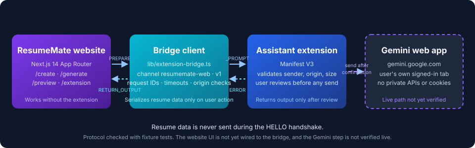

# Architecture

ResumeMate has two applications in one repository. Each builds, tests, and ships on its own.

```text
apps/web        Next.js 14.2 App Router website (resume form, templates, preview)
apps/extension  ResumeMate Assistant, Manifest V3 Chrome extension (bundle only, see below)
docs/           Architecture, integration, deployment, security, SEO, and test reports
```



## Components

| Component | Location | Responsibility |
| --- | --- | --- |
| Website | `apps/web/app`, `apps/web/components` | Resume entry, templates, preview. Works with no extension installed. |
| Bridge client | `apps/web/lib/extension-bridge.ts` | Builds the versioned envelope, serializes resume data on user action, checks replies by origin, source, and request ID. |
| Resume model | `apps/web/lib/resume.ts` | Structured resume and validation. |
| Import checks | `apps/web/lib/pdf-import.ts`, `apps/web/lib/latex-import.ts` | Library code for text-PDF and `.tex` checks. Not connected to the upload UI. |
| Compile wrapper | `apps/web/services/latex-compile/compile.mjs` | Runs `pdflatex` with shell escape off. Not a sandbox. Not deployed. |
| Extension background | `apps/extension/background/service-worker.js` | Validates messages, holds the active request, talks to the Gemini tab, returns output. |
| Website content script | `apps/extension/content/resumemate.js` | Runs on `https://prajwalkedari.tech/*`. Relays messages between the page and the service worker. Checks the sender and origin. |
| Gemini content script | `apps/extension/content/gemini.js` | Runs on `https://gemini.google.com/app*`. Places and submits prompts only on user approval. |
| Popup | `apps/extension/popup/` | Shows the request for review and the approval controls. |

## Trust boundaries

1. **Page to content script.** `window.postMessage` is checked against the page origin and the envelope (`channel`, `v`, `direction`).
2. **Content script to service worker.** `chrome.runtime` messages are accepted only from the extension's own context.
3. **Service worker to Gemini tab.** Only the Gemini tab that the user opened is used. The extension does not read cookies, tokens, or private APIs.
4. **Output back to the page.** Output is returned only after the user has reviewed it in the extension.

## Why the extension is separate

The extension runs in the user's own browser profile, so it can use the user's Gemini sign-in without ResumeMate ever holding Google credentials. The website stays usable when the extension is absent.

## Not in this repository

- The extension's TypeScript source (`src/`), tests, and build script. The bundle is verified as shipped, but it cannot be rebuilt from here.
- A monorepo workspace setup (npm workspaces). Each app keeps its own lockfile.
- `packages/shared`. Not created, because the protocol is small and the two apps are built from different toolchains.
